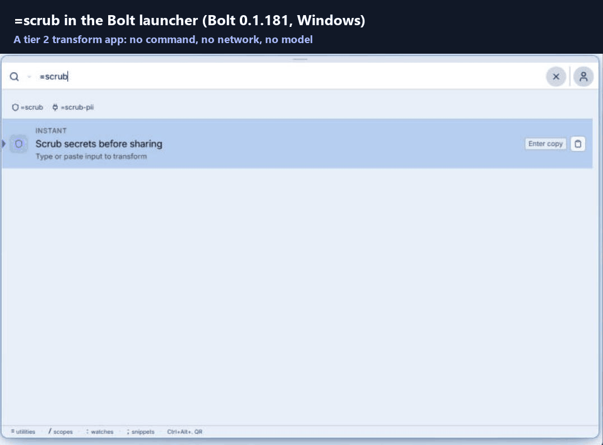

# share-safe: a Bolt App that scrubs secrets before you share

A small extension for [Bolt](https://sparcle.app/bolt/), plus an offline test runner and notes from
building it as an outside author. Tested in Bolt 0.1.181 on Windows.



**Headline finding:** on the same pasted JSON, Bolt's built-in Paste-Guard copies
`"password": "hunter2"` unchanged, and it ignores `Cookie:` headers. `=scrub` masks both. Details
are in [FINDINGS.md](FINDINGS.md).

## What's here

| Path | What it is |
|---|---|
| [`apps/share-safe/`](apps/share-safe/) | `=scrub`: paste a log, HTTP exchange, JSON response or `.env` and copy it back with tokens, keys, cookies, passwords and emails masked. Tier 2 (`runtime: transform`): no command, no network, no model. |
| [`tools/transform-test.mjs`](tools/transform-test.mjs) | Runs the `transform` and `recognizer` tests in a `bolt-app.json` offline. The official toolkit checks the shape of these tests but does not run them. |
| [`FINDINGS.md`](FINDINGS.md) | What I found, with each finding marked as tested in Bolt or offline: Paste-Guard gaps, `recognize` being required for pasted blocks, install text that overstates what a transform can do, and toolkit and doc issues. |

## Example

```
GET /v1/me HTTP/1.1
Authorization: Bearer eyJhbGciOi...
Cookie: session=7f3a9c
{"status": 401, "error": "TOKEN_EXPIRED", "user": "asha@example.com", "password": "hunter2"}
```

becomes

```
GET /v1/me HTTP/1.1
Authorization: Bearer [REDACTED]
Cookie: [REDACTED]
{"status": 401, "error": "TOKEN_EXPIRED", "user": "[EMAIL]", "password": "[REDACTED]"}
```

## Try it

**In Bolt:**
1. Go to Settings → Desktop App → User Apps → Open folder.
2. Copy `apps/share-safe/utilities/scrub.yaml` into that folder, click Reload, then expand the app
   and click **Review and accept**.
3. For a one-line paste, type `=scrub` followed by a space, then paste.
4. For a multi-line block, just paste it. Bolt offers **Convert → Scrub secrets before sharing**
   whenever the block contains something to mask.

**Run the tests** (Node 18 or newer, plus a clone of
[SparcleHQ/bolt-apps](https://github.com/SparcleHQ/bolt-apps); the runner reuses its YAML reader):

```bash
git clone --depth 1 https://github.com/SparcleHQ/bolt-apps
node tools/transform-test.mjs apps/share-safe --bolt-apps bolt-apps
```

**Lint and pack** with the official toolkit:

```bash
node bolt-apps/toolkit/bin/bolt-apps.mjs lint apps/share-safe
node bolt-apps/toolkit/bin/bolt-apps.mjs verify apps/share-safe
```
